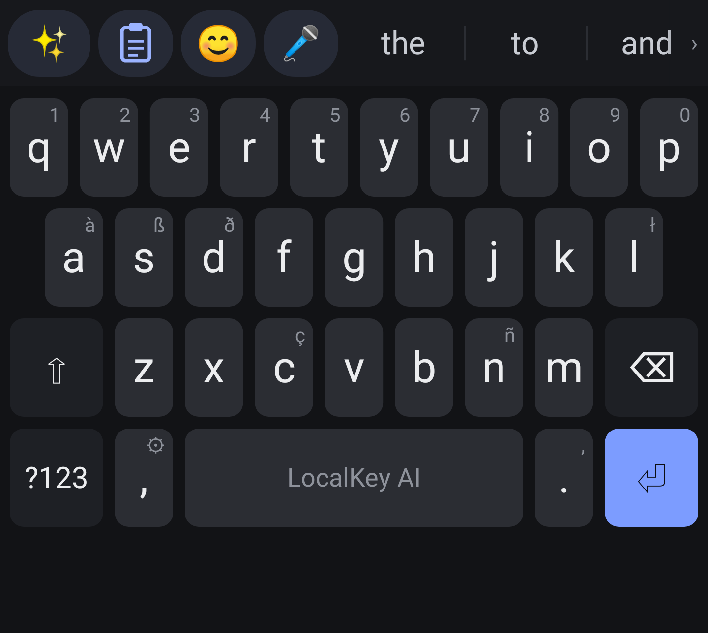
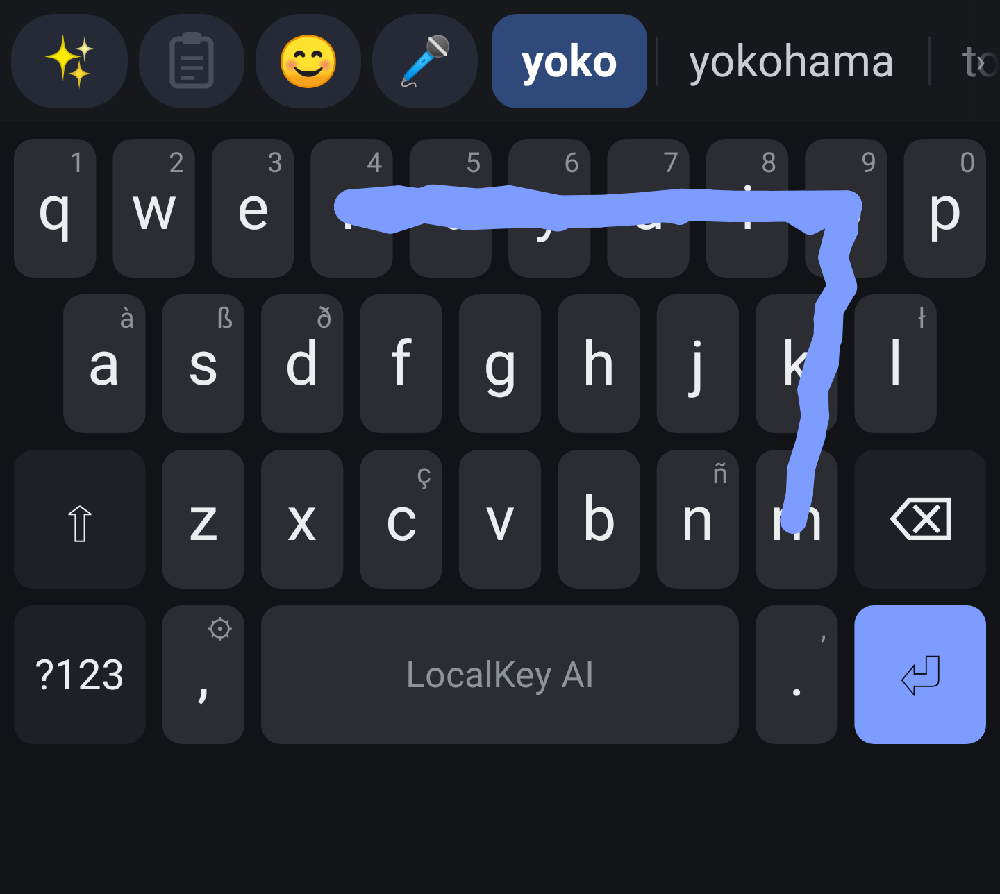
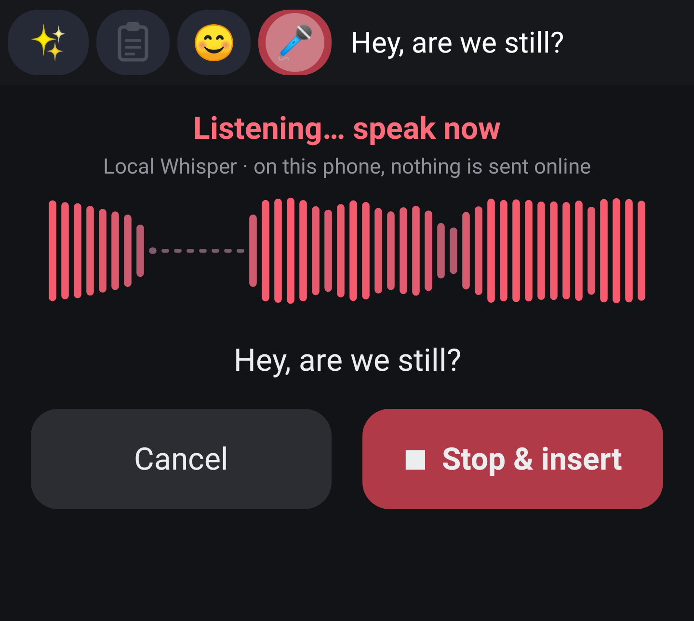

# LocalKey AI

A fully on-device AI keyboard for Android (arm64, Android 11+). Nothing you type or say leaves the phone: the app has no INTERNET permission.

<p>



</p>

## Features
- **✨ AI rewrite chips**: Fix grammar, Polite, Shorter, Casual. Runs Qwen2.5-0.5B-Instruct (Q4_K_M) through llama.cpp, on the selected text or the whole field.
- **🎤 Voice typing**: Whisper base.en (q5_1) through whisper.cpp, with live partial text, auto-stop, punctuation and capitals. You can also switch to Android's on-device recognizer. Includes a voice diagnostics screen.
- **Swipe typing** with a trail, a live suggestion bar that updates mid-swipe, and the current word highlighted.
- **Scrollable suggestion bar** with up to 15 suggestions. Your typed word is always kept.
- **Personal learning**: word sequences, adaptive autocorrect, a typo model, and your style for AI rewrites. Learned data can be exported, imported or cleared in Settings, and stays on the device.
- **😊 Emoji panel** with about 1,900 emoji, recents and skin tones, plus a **paste** button.
- Keeps the keyboard clear of the navigation bar (gesture or 3-button navigation).

More screenshots are in [docs/screenshots](docs/screenshots).

## Install
Download `LocalKey-AI-v8.1-arm64.apk` from [Releases](../../releases), install it, then open LocalKey AI and follow the steps to enable and choose the keyboard.

The package name is still `com.jason.aikeyboard`, and the release is signed with the same key as the earlier "AI Keyboard" builds (v1 to v8), so it installs over them as an update and keeps your learned data. Changing either one would break updates.

If you got the APK as split parts (`*.apk.part00` …), join them first:
- Termux: `cat LocalKey-AI-v8.1-arm64.apk.part0* > LocalKey-AI.apk`
- Windows: `copy /b file.part00+file.part01+... LocalKey-AI.apk`

## Build
Requirements: Linux, JDK 17+, Android SDK (build-tools 36.0.0, platform android-36), Android NDK, CMake + Ninja, Python 3, curl.

```bash
git clone --recursive https://github.com/NinjaCatP/LocalKey-AI.git && cd LocalKey-AI
scripts/fetch_models.sh             # downloads both models from Hugging Face into models/
ANDROID_NDK=/path/to/ndk scripts/build_native.sh
cp local.properties.example local.properties   # fill in your keystore path, alias and passwords
ANDROID_SDK=/path/to/sdk ./build.sh # -> output/LocalKey-AI-v8.1-arm64.apk
```

Signing secrets come only from environment variables (`AIK_KEYSTORE`, `AIK_KEY_ALIAS`, `AIK_STORE_PASS`, `AIK_KEY_PASS`) or a gitignored `local.properties`. No keystore or password is in this repo. A build signed with a different key can't update an existing install.

The models are bundled uncompressed and 16 KB aligned inside the APK, and read in place. The APK is about 558 MB, so it's distributed as a GitHub Release asset, not in git.

**Models** (`scripts/fetch_models.sh`):
- `qwen2.5-0.5b-instruct-q4_k_m.gguf` from `Qwen/Qwen2.5-0.5B-Instruct-GGUF`
- `ggml-base.en-q5_1.bin` from `ggerganov/whisper.cpp`

**Native dependencies** are git submodules pinned to the exact commits used: llama.cpp `cd0a5b6a` and whisper.cpp `0c7be696`.

## Tests
`test/run_tests.sh` runs JVM and Robolectric tests (about 82). They need host builds of the native libraries and the models, and the script currently uses the original author's machine paths, so adjust it before running. The voice WAV clips (TTS generated) aren't included. `test/voice/sentences.txt` and `wer.py` are there to regenerate them.

## Privacy
No network permission, no analytics, no accounts. AI rewrites, voice recognition and learning all run on the phone. Learned-data exports are plain text and not encrypted, so keep them private.

## License
MIT © 2026 Jason Borghese. See [LICENSE](LICENSE) and [THIRD_PARTY_NOTICES.md](THIRD_PARTY_NOTICES.md) for bundled models and libraries. The word list is CC BY-SA 4.0.
